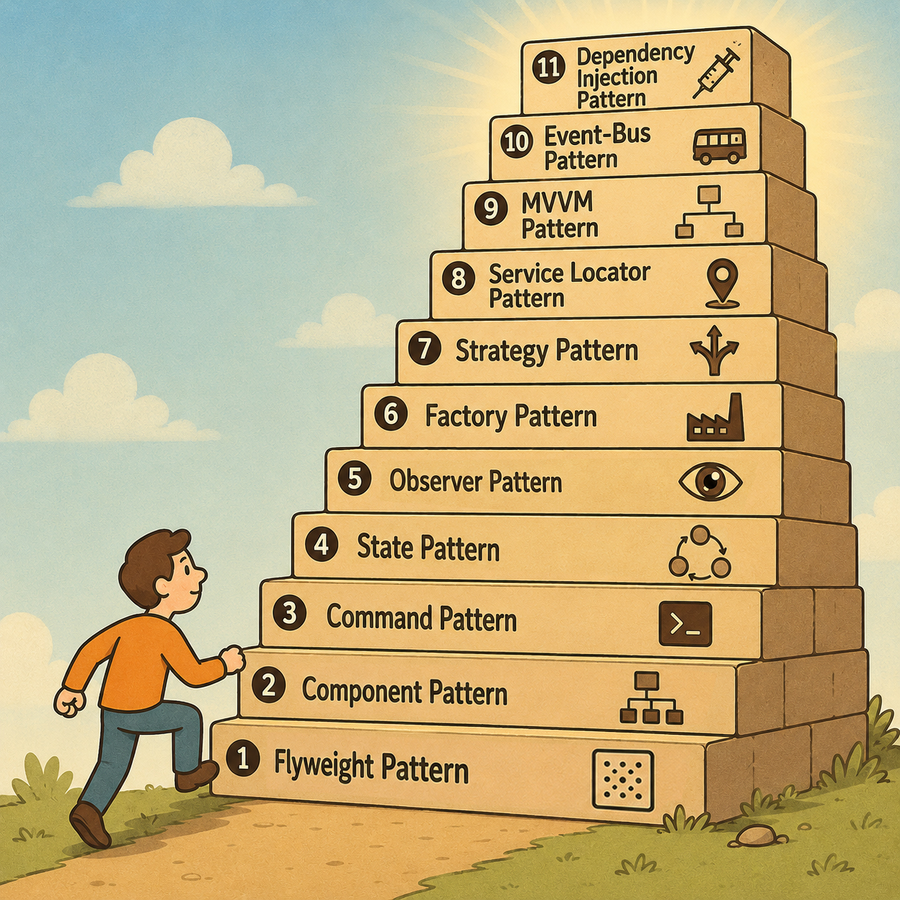

### Hakkımda
Hi 👋, I'm Unity blogger from Turkey

- **Engineering**: 
- **Project Setup & Settings**: 
- **User Interface**: 
- **Physics**: 
- **3rd Libraries**: 

---

  

---

## Working Structure

### Player

* Rigidbody / uygun fizik bileşeni (One object must have a Rigidbody)
  * `Use Gravity`: Kapalı
  * `Constraints`: Freeze Position: Y
  * `Constraints`: Freeze Rotation: X ve Z
* Collider (Both objects must have Collider)
* PlayerCollision Script
* Is Trigger ❌
* Tag = Player

### Enemy

* Collider
* Is Trigger ❌
* Tag = Obstacle

### EndTrigger

* Collider (Both objects must have Collider)
* Is Trigger ✔
* EndTrigger Script

### GameManager

* GameOverUI assigned
* CompleteLevelUI assigned

